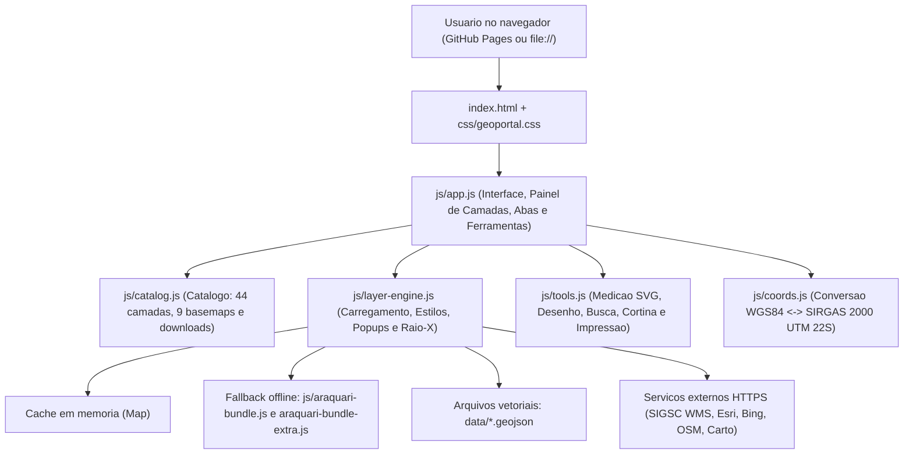

# Arquitetura Geoespacial — Geoportal Araquari (SC)

Este documento descreve como o Geoportal Municipal de Araquari funciona por dentro (em linguagem acessível para gestores e técnicos não programadores) e detalha sua estrutura técnica de módulos, esquemas de configuração e fluxo de atualização de dados.

---

## 1. Como funciona na prática (sem termos complicados)

O Geoportal Araquari é uma aplicação **100% estática**, ou seja, não precisa de banco de dados ligado (como PostgreSQL/SQL Server) nem de servidor de mapas pago (como ArcGIS Server) para funcionar na internet. Ele roda inteiramente no navegador do cidadão ou do técnico, hospedado gratuitamente no **GitHub Pages** (`https://eriksdhoffmann.github.io/Geoportal-Araquari/`) ou aberto diretamente no computador pelo arquivo `index.html` (`ABRIR_GEOPORTAL_ARAQUARI.bat`).

- **Leaflet 1.9.4** faz o papel do "motor do mapa": move a tela, dá zoom e posiciona as camadas geográficas.
- **Canvas HTML5** desenha rapidamente camadas vetoriais com centenas ou milhares de linhas/polígonos sem travar o navegador.
- **SVG** desenha na camada superior (`zIndex: 650`) as medições de distância e área, desenhos do usuário e destaques de busca.
- **OGC WMS HTTPS** conecta o portal aos mapas de imagem oficiais do Estado de Santa Catarina (**SIGSC**), carregando apenas os quadradinhos (*tiles*) visíveis na tela.
- **GeoJSON + Bundles JS** guardam os vetores locais de Araquari em formato leve (`data/*.geojson`) e em pacotes JavaScript de contingência (`js/araquari-bundle.js` e `js/araquari-bundle-extra.js`) para funcionar inclusive offline via `file://`.

---

## 2. Inventário de Arquivos e Módulos do Projeto

| Arquivo / Pasta | Papel no Sistema |
| :--- | :--- |
| `index.html` | Estrutura principal: cabeçalho institucional (brasão da Prefeitura + logo), barra de busca unificada, barras de ferramentas esquerda/direita, painel `Controle de Camadas`, barra de status inferior e modal de abas (`Início`, `Download`, `Emissão de Documentos`, `Ajuda`). |
| `css/geoportal.css` | Folha de estilos no padrão visual institucional azul/esmeralda (`--brand-navy: #033c8e`, `--brand-blue: #0b5cb8`, `--brand-emerald: #059669`), responsividade e layout de impressão PDF. |
| `js/coords.js` | Matemática geodésica em tempo real: conversão elipsoidal **WGS84 (EPSG:4326)** ↔ **SIRGAS 2000 / UTM Fuso 22S (EPSG:31982)**, formatação DMS, leitura de coordenadas digitadas na busca, distância Haversine, área geodésica e denominador de escala (`1 : N`). |
| `js/catalog.js` | Registro declarativo de todos os **9 mapas base** (`BASEMAPS`), **9 grupos / 44 camadas vetoriais** (`LAYER_GROUPS`), itens da aba Download (`OFFICIAL_DOWNLOADS`) e combos temáticos da aba Início (`THEMATIC_PRESETS`). |
| `js/layer-engine.js` | Motor GIS: criação de *panes* exclusivos por camada, máscara vetorial de recorte pelo limite IBGE `4201307`, carregamento com fallback local/remoto, estilização por categoria (`colorMap`), popups (`buildFeaturePopupHtml`), legendas ativas (`getActiveLegends`), Raio-X ponto-em-polígono (`identifyAtPoint`), exportação GeoJSON e importação de `.zip` (via `shpjs@4.0.4`), `.geojson` e `.kml` com reprojeção cliente de UTM 22S para WGS84. |
| `js/tools.js` | Ferramentas interativas em `paneToolsOverlay` (`zIndex: 650`): zoom por retângulo, histórico de vista (Undo/Redo), GPS, medição de distância/área, desenho/anotação exportável em GeoJSON, busca unificada em camadas e logradouros, e cortina temporal arrastável (`swipe`). |
| `js/app.js` | Controlador central de eventos, renderização das abas (`Camadas`, `Ordem`, `Legenda`), barra de status de coordenadas/escala e modais de navegação. |
| `js/limite-araquari.js` | Polígono de limite oficial IBGE `4201307` pré-carregado para a máscara de recorte municipal. |
| `js/araquari-bundle.js` | Pacote instantâneo com **35 camadas** para operação imediata e offline (`file://`). |
| `js/araquari-bundle-extra.js` | Pacote complementar carregado sob demanda com **8 camadas** mais pesadas (`fbds_uso_solo`, `fbds_app`, `fbds_rios_simples`, `ima_licenciamento`, `ima_autos_infracao`, `sigsc_ottobacias`, `curvas_nivel_araquari`, `sistema_viario_araquari`). |
| `data/*.geojson` | **44 arquivos GeoJSON** em WGS84 (EPSG:4326), totalizando ~4,70 MB (`4.811,16 KB`). |
| `assets/` | Brasão oficial da Prefeitura de Araquari (`logo-prefeitura-araquari.png`). |
| `ABRIR_GEOPORTAL_ARAQUARI.bat` / `FAZER_PUSH_GITHUB.bat` | Atalhos Windows para abertura local e publicação rápida no GitHub Pages (`main`). |

---

## 3. Empilhamento de Camadas (*Panes*) e Ordem Visual

Para evitar que camadas fiquem escondidas atrás de outras por ordem de resposta da rede, `js/layer-engine.js` cria camadas de profundidade (*panes*) fixas no Leaflet:

| *Pane* | `zIndex` | O que desenha |
| :--- | :---: | :--- |
| `paneBasemapUnderlay` | `195` | Satélite HD contínuo sob ortofotos recortadas |
| `paneBasemapGlobal` | `200` | Mapas base globais (Esri, Bing, OSM, Carto) |
| `paneBasemapMunicipal` | `210` | Ortoimagem e modelos digitais SIGSC (WMS) |
| `paneBasemapLabels` | `218` | Rótulos e vias de referência do modo Híbrido |
| `paneSwipeRight` | `222` | Camada do lado direito na Cortina Comparativa |
| `paneMunicipalMask` | `230` | Máscara branca externa ao limite de Araquari (`4201307`) |
| `paneLayer_<id>` | `410 + 4*i` | Cada camada vetorial ativa em `layerOrder` (controlada na aba `Ordem`) |
| `paneToolsOverlay` | `650` | Medições, desenhos e destaques de busca/identificação |

---

## 4. Esquema de uma Camada em `js/catalog.js`

Cada objeto dentro de `LAYER_GROUPS[i].layers` segue a estrutura abaixo:

| Campo | Obrigatório | Função |
| :--- | :---: | :--- |
| `id` | Sim | Identificador único em snake_case (ex.: `fbds_uso_solo`). |
| `name` | Sim | Nome exibido no Controle de Camadas, na aba Ordem e nos popups. |
| `localFile` | Sim* | Caminho relativo do GeoJSON em `data/` (ex.: `data/fbds_uso_solo.geojson`). |
| `bundleKey` | Não | Chave correspondente dentro de `window.GEOARAQUARI_BUNDLE`. |
| `isExtraBundle` | Não | Se `true`, carrega sob demanda `js/araquari-bundle-extra.js` quando aberto via `file://`. |
| `geomType` | Sim | `'polygon'`, `'line'` ou `'point'`. |
| `defaultOn` | Não | Se `true`, liga automaticamente na inicialização (hoje: `limite_municipal_ibge` e `bairros_araquari`). |
| `opacity` | Não | Transparência inicial de `0.0` a `1.0`. |
| `outlineMode` | Não | Quando `true`, limita o preenchimento para destacar apenas o contorno. |
| `style` / `pointStyle` | Não | Estilo Leaflet padrão (`color`, `weight`, `dashArray`, `fillColor`, `fillOpacity`, `radius`). |
| `colorField` / `colorMap` | Não | Campo categórico + dicionário `{ valor: '#hex' }` para estilização temática e geração da legenda. |
| `labelField` | Não | Campo de texto exibido no mapa como rótulo a partir do zoom `12`. |
| `titleField` | Não | Campo usado no *tooltip* ao passar o mouse e no título do popup. |
| `subtitleFields` | Não | Lista ordenada de atributos prioritários exibidos no popup (`buildFeaturePopupHtml`). |
| `officialUrl` | Não | Link externo para a fonte oficial original (exibido no menu `•••` da camada). |
| `description` | Recomendado | Resumo técnico mostrado ao abrir opções (`•••`) da camada. |

---

## 5. Como Adicionar ou Atualizar uma Camada (Passo a Passo via QGIS)

1. **Preparar no QGIS:**
   - Abra ou desenhe os dados no QGIS, confira se todas as geometrias são válidas (*Vetor → Geometrias → Verificar validade*) e se cobrem o município de Araquari.
   - Revise os nomes das colunas (evite acentos ou espaços nos nomes internos dos campos; use nomes simples como `nome`, `classe`, `fonte`, `area_ha`).
2. **Exportar em GeoJSON (WGS 84):**
   - Clique com o botão direito na camada → **Exportar → Guardar elementos como...**.
   - Escolha o formato **GeoJSON**.
   - **SRC (Sistema de Coordenadas):** selecione obrigatoriamente **`EPSG:4326 - WGS 84`**.
   - Precisão de coordenadas recomendada: `5` casas decimais (aprox. 1 metro, mantendo o arquivo leve para a web).
   - Salve dentro da pasta `data/` do projeto com o nome exato da camada (ex.: `data/nova_camada.geojson`).
3. **Registrar ou atualizar os pacotes offline (Bundles):**
   - **Se estiver apenas atualizando uma camada que já existe** (mantendo o mesmo nome de arquivo em `data/`): o sistema via web/GitHub Pages já lê o arquivo novo automaticamente! Contudo, para que a versão offline (`file://`) e a busca rápida também tenham os dados atualizados, é necessário atualizar o respectivo campo dentro de `js/araquari-bundle.js` (ou `araquari-bundle-extra.js`) rodando o script gerador ou atualizando o JSON correspondente.
   - **Se for uma camada inédita:** adicione a entrada dela dentro de um grupo em `js/catalog.js` seguindo o esquema da Seção 4 e registre também na lista de downloads, se a licença permitir.
4. **Publicar no GitHub:**
   - Dê dois cliques em `FAZER_PUSH_GITHUB.bat` (ou execute `git add .`, `git commit`, `git push origin main`). O GitHub Pages publica a atualização automaticamente em cerca de 30 segundos a 2 minutos.

---

## 6. Lacunas Estruturais do Código Atual Frente ao Referencial de Florianópolis

Ao comparar o código atual com os objetivos do projeto e o GeoPortal de Florianópolis (`geoportal.pmf.sc.gov.br`), faltam implementar na interface e no motor (previsto para as próximas fases):

1. **Ficha de metadados consultável por camada** (botão/aba exibindo os 21 campos obrigatórios de origem, data, escala, licença e restrições).
2. **Explicação didática ("O que é isto?") por camada, por classe na legenda e dentro do popup** (ex.: explicar o que significa cada sigla de zoneamento ou classe ambiental em português claro).
3. **Selo/distinção visual clara entre dado Oficial, Científico, Colaborativo (OSM) e Digitalização não oficial de anexo de lei.**
4. **Página/aba dedicada de Downloads com buscador instantâneo**, contemplando todas as camadas redistribuíveis (hoje 20 das 44 camadas nem sequer constam em `OFFICIAL_DOWNLOADS` e o modal atual não possui filtro de busca).
5. **Controle de visibilidade por escala (`minZoom`/`maxZoom`)** no `layer-engine.js`, indispensável quando entrarem camadas pesadas como quadras, edificações, parcelas ou CNEFE.
6. **Camadas cadastrais, Plano Diretor e indicadores censitários** (hoje inexistentes ou incompletas).
